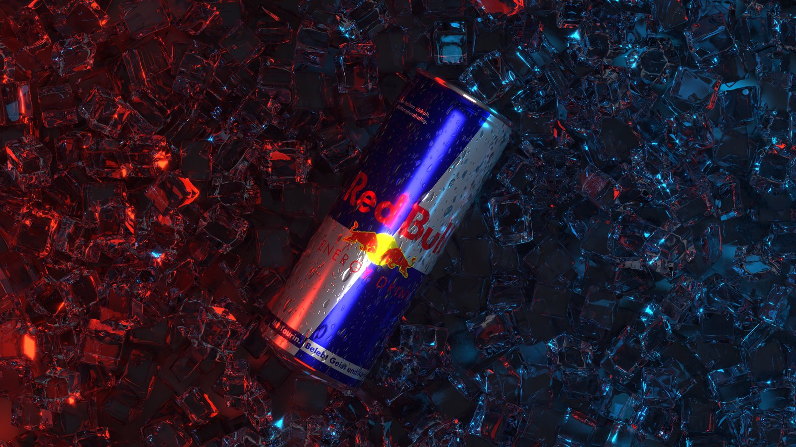

<div align="center">

# 🎬 3D Portfolio

**Blender projects, reusable tools, and the process behind them.**




</div>

---

## About

A mechanical engineering student's 3D lab: finished projects with process breakdowns, plus the Python tools I write to speed up Blender work. Every project folder has its own README covering goal, tools, settings, and lessons learned.

I'm open to freelance 3D visualization work and remote internships. See [Contact](#contact).

## Projects

| Project | Category | Tools | Status | Preview |
|---|---|---|---|---|
| [**RED**: energy drink on ice](projects/redbull-drink/) | Product visualization | Blender 5.2, Cycles, Geometry Nodes | ✅ Complete | [](projects/redbull-drink/) |
| [**Droplet Generator**](projects/droplet-generator/) | Procedural tool | Python (`bpy`), Cycles | 🚧 In progress | _render coming_ |

New projects are scaffolded with [`scripts/utils/new_project.py`](scripts/utils/new_project.py).

## Tools

| Script | What it does |
|---|---|
| [`droplet_generator.py`](scripts/blender/droplet_generator.py) | Scatters non-overlapping, area-weighted water droplets over any mesh |
| [`new_project.py`](scripts/utils/new_project.py) | Creates a project folder with the standard subfolders and README template |

Full index and usage: [`scripts/`](scripts/).

## Stack

| Stage | Tool |
|---|---|
| 3D creation | Blender 5.x |
| Rendering | Cycles (GPU, OptiX/CUDA) |
| Color grading | DaVinci Resolve |
| Automation | Python (`bpy`) |

**Hardware:** NVIDIA RTX 4050

## Repository structure

```
3D-PORTFOLIO/
├── README.md
├── LICENSE                 # MIT, applies to code and scripts
├── LICENSE-ARTWORK.md      # All rights reserved, applies to renders and scenes
├── .gitattributes          # Git LFS rules
│
├── projects/               # One folder per project (kebab-case)
│   ├── _template/          # README template used by new_project.py
│   ├── redbull-drink/
│   │   ├── README.md
│   │   ├── source/         # .blend scene (LFS)
│   │   └── renders/        # thumbnail.jpg + final-4k.png (LFS)
│   └── droplet-generator/
│       ├── README.md
│       ├── source/
│       └── renders/
│
├── scripts/                # Automation, grouped by software
│   ├── blender/
│   ├── resolve/
│   └── utils/
│
├── assets/                 # Reusable models and props (empty for now)
├── materials/              # Reusable materials and node groups (empty for now)
├── presets/                # Render, export, and color presets (empty for now)
└── docs/                   # Workflow notes and README images
    ├── workflow.md
    └── images/hero.jpg
```

Each project follows the same layout: `README.md`, `source/`, `renders/`, and, where needed, `exports/`, `references/`, `textures/`, `post/`.

## Getting started

```bash
git lfs install
git clone https://github.com/yashvardhansingh442-dev/3D-PORTFOLIO.git
cd 3D-PORTFOLIO
```

1. Open a project's README under [`projects/`](projects/).
2. Open the `.blend` in `source/` with Blender 5.x.
3. If textures look missing: **File → External Data → Find Missing Files**.

> Large binaries are stored with Git LFS. If a `.blend` is a tiny text file, run `git lfs pull`.

## Conventions

- **Folders:** `kebab-case` (`redbull-drink`). **Scripts:** `snake_case.py`.
- **Blender objects:** `Category_Name_Variant`. **Materials:** `MAT_Name`. **Node groups:** `NG_Name`.
- **Thumbnails:** `renders/thumbnail.jpg`, 800 px wide. **README hero images:** compressed JPG, 1600 px wide.
- **Heavy binaries** (`.blend`, EXR/HDR, 4K PNG, video) go through Git LFS; see [`.gitattributes`](.gitattributes).
- **Commits:** short, present tense (`Add lighting setup for hero shot`).

Process notes: [`docs/workflow.md`](docs/workflow.md).

## Roadmap

- [ ] Render and commit the Droplet Generator demo scene and thumbnail
- [ ] Add render settings (samples, denoiser, render time) to the RED README
- [ ] Add `batch_render.py` to `scripts/blender/`
- [ ] Add 3–5 reusable materials to `materials/`
- [ ] Record a turntable for each project
- [ ] Add an animation or product-ad project

## License

- **Code and scripts:** [MIT](LICENSE).
- **Renders, models, and scene files:** all rights reserved, see [LICENSE-ARTWORK.md](LICENSE-ARTWORK.md). You're welcome to learn from the process; please ask before reusing the artwork.

## Contact

- **Behance:** https://www.behance.net/avusingh
- **GitHub:** [@yashvardhansingh442-dev](https://github.com/yashvardhansingh442-dev)
- **Email:** yashvardhansingh442@gmail.com
