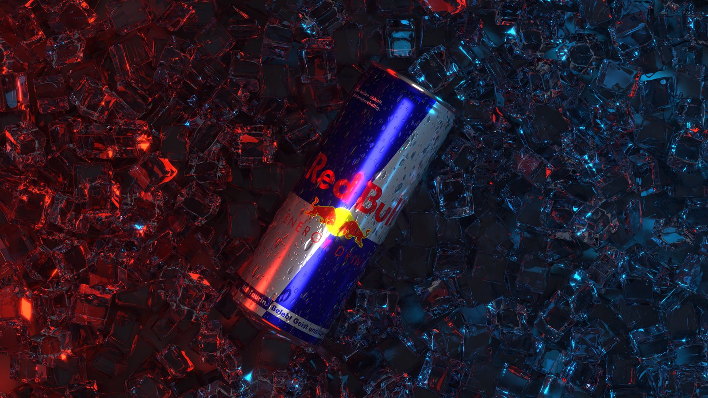

# 🧊 RED — Energy Drink on Ice (Blender / Cycles)

A cinematic 3D product shot of an energy drink can resting on a bed of crystal-clear ice cubes, split-lit with a hot **red** key on the left and a cold **cyan-blue** key on the right. Condensation droplets cover the can, and the whole scene is rendered in 4K with Cycles.



> **Resolution:** 3840 × 2160 (4K UHD) · **Renderer:** Cycles · **Blender:** 5.2 · Full-resolution render: [`renders/final-4k.png`](renders/final-4k.png)

---

## Overview

This project is a product-ad style study built to practice the things that make commercial 3D shots sell:

- **Hero object** — a detailed aluminium can with a printed label and a brushed-metal body
- **Hard-to-render materials** — refractive ice with internal reflections, wet surfaces, and anisotropic metal highlights
- **Colour contrast lighting** — warm vs. cool lighting to create depth, mood, and a strong visual split
- **Surface storytelling** — procedural condensation to sell the "ice cold" feeling

## Scene Breakdown

| Element | Details |
|---|---|
| **Can** | Aluminium body with label texture (`Material.001_baseColor.png`) and metallic shader |
| **Ice cubes** | Dense pile of transparent glass-style cubes with refraction and internal caustics-like highlights |
| **Condensation** | Procedural droplets generated with a Geometry Nodes group (`Condensation Particles`) and a dedicated `Droplet` material |
| **Lighting** | Multiple Area lights, red on one side and blue on the other, plus HDRI environment lighting |
| **Camera** | Top-down, slightly angled composition with depth of field focused on the can |
| **Compositing** | Compositor node tree used for final grading |

## Technical Details

- **Software:** Blender 5.2
- **Render engine:** Cycles
- **Output:** 3840 × 2160 PNG
- **Lighting:** 6+ area lights and HDRI-based environment lighting
- **Shading:** Principled BSDF–based materials for metal, glass/ice, and water droplets
- **Procedural work:** Geometry Nodes for the droplet distribution
- **Render samples / denoiser / render time:** _add your numbers here_
- **Hardware:** NVIDIA RTX 4050

## Files

```
redbull-drink/
├── README.md
├── source/
│   └── redbull-drink.blend    # Full Blender scene (Git LFS)
└── renders/
    ├── thumbnail.jpg          # 800 px preview used in the main README
    └── final-4k.png           # Final 3840 × 2160 render (Git LFS)
```

> The README hero image is a compressed 1600 px copy at [`docs/images/hero.jpg`](../../docs/images/hero.jpg).

## How to Open

1. Install [Blender](https://www.blender.org/download/) **5.2 or newer** (older versions may not open this file correctly).
2. Open `source/redbull-drink.blend` (run `git lfs pull` first if the file is only a few bytes).
3. Make sure the render engine is set to **Cycles**. GPU compute is strongly recommended for the ice.
4. Press **F12** to render, or switch the viewport to **Rendered** to preview.

> ⚠️ The scene contains many refractive objects, so expect heavy render times. For quick previews, lower the sample count and use the denoiser, or reduce the resolution percentage in **Output Properties**.

## Tips for Modifying the Scene

- **Change the mood:** edit the colour and strength of the red and blue Area lights.
- **More or fewer droplets:** adjust the inputs of the `Condensation Particles` Geometry Nodes modifier.
- **Faster renders:** reduce **Light Paths → Max Bounces** (particularly Transmission) and lower the samples.
- **Different label:** swap the image in the label material's Image Texture node.

## Credits

- Modeling, shading, lighting, and rendering: **Yash** ([@yashvardhansingh442-dev](https://github.com/yashvardhansingh442-dev))
- HDRIs used in the scene: `cayley_interior_4k` and `satara_night_no_lamps_2k` (check the source's licence, e.g. [Poly Haven](https://polyhaven.com/), before redistributing)

## Disclaimer

This is a personal, non-commercial portfolio and learning project. The can design, name, and logo are trademarks of their respective owner and are used here only for practice. This project is not affiliated with, endorsed by, or sponsored by that company. Please don't use the render or the scene for commercial purposes.

## License

Scene file and render: all rights reserved, see [LICENSE-ARTWORK.md](../../LICENSE-ARTWORK.md). Shared for portfolio and learning purposes only.
